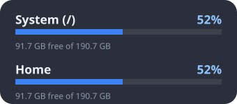

# Snowmeter

Snowmeter is a desktop customization tool for Linux that reads Windows
[Rainmeter](https://www.rainmeter.net/) skins. It is written in Rust with GTK 4
and Cairo, and it follows the behaviour of stock Rainmeter 4.5: the same
`.ini` skin format, the same measures, meters, variables and bangs, the same
`.rmskin` packages. Skins sit on the desktop as transparent windows and update
live.

Snowmeter is licensed under the MIT License (see `LICENSE`). It is an independent
project and is not affiliated with, endorsed by or derived from the Rainmeter
project or its authors.

## Bundled skins

Three plain Rainmeter skins ship in `skins/Snowmeter/`. They use only standard
options, so they also run on Windows Rainmeter 4.5. They share one palette in
`@Resources/Variables.inc`.

| Skin | Preview |
|---|---|
| `Snowmeter\Weekday`: clock, full date and a Mon-Sun strip with today highlighted |  |
| `Snowmeter\System`: CPU, memory and swap rings |  |
| `Snowmeter\Disk`: used and free space for `/` and `/home` |  |

To use them, copy `skins/Snowmeter` into `~/.config/snowmeter/skins/`, then
`snowmeter load 'Snowmeter\Weekday'`.

Two more skins ship in `skins/` (copied into your skins folder on start):

- **Monterey** (`skins/Monterey`): macOS Monterey widgets ported from
  creewick's Rainmeter skin: Clock (any time zone), Calendar, Weather
  (Open-Meteo with city search), Music (Spotify and any MPRIS player), Volume
  (system and per-app) and Timer, each in Small 1x1, Medium 2x2, Wide 4x2 and
  Large 4x4; Light, Dark, Auto, Color (from your wallpaper) and Blur themes;
  eight languages. Open `Monterey\Settings.ini` to turn widgets on and pick a
  theme, language and units; right-click a widget for its sizes.
- **Mond Remake** (`skins/MondRemake`): an original, lightweight remake of the
  Mond look: big spaced day name with date and time, a music player and a
  weather widget with a 5-day forecast. Right-click for 12/24-hour time,
  units, city search and the settings file (location, colours, player,
  language).

The original Mond package is still available with `snowmeter install Mond`.

## Resizing and menus

Every skin can be resized, whatever its author planned: right-click >
**Size** (50% to 300%), Ctrl+mouse wheel over the skin, or
`snowmeter scale <config> <percent>`. The size is remembered per skin
(`Scale=` in `snowmeter.ini`).

The right-click menu shows the skin's own entries (`ContextTitle` /
`ContextAction`), its **Variants** (other `.ini` files of the config, e.g.
Monterey's sizes), **Size**, **Edit skin** and the usual toggles. Skins that
open their own menu (`!SkinCustomMenu`) still give you Snowmeter's menu with
Ctrl+right-click.

## Requirements

- Rust (stable) installed with [rustup](https://rustup.rs/)
- GTK 4.14 or newer with development files
- Debian, Ubuntu and Linux Mint packages:

```
sudo apt install libgtk-4-dev libcairo2-dev libpango1.0-dev libfontconfig-dev build-essential
```

- Optional: the `wayland-layer-shell` cargo feature is a placeholder. It does
  not link `gtk4-layer-shell` yet and only logs a message, so it changes nothing
  today (see Desktop environments).

## Build and install

```
cargo build --release
target/release/snowmeter            # start the app
cargo install --path crates/snowmeter   # optional
cargo clean                         # optional: frees the ~1 GB build folder
```

Snowmeter uses GTK's Cairo renderer by default (skins are drawn with Cairo, and
the GL/Vulkan renderers roughly double its private memory). Start it with
`GSK_RENDERER=ngl snowmeter` to use another renderer.

## Usage

`snowmeter` with no arguments starts the app. It loads every skin marked
`Active=N` in `snowmeter.ini` (on first start, the bundled skins), opens the
control socket and shows a tray icon. The other commands talk to the running
instance over a Unix socket (`$XDG_RUNTIME_DIR/snowmeter.sock`).

| Command | Running instance | Not running |
|---|---|---|
| `snowmeter load <config> [file.ini]` | loads the skin | marks it active in settings and prints a hint |
| `snowmeter unload <config>` | unloads it | marks it inactive |
| `snowmeter list` | configs and active state | same, read from disk |
| `snowmeter refresh [config]` | refreshes | error "not running" |
| `snowmeter import <file.rmskin or folder>` | runs locally, then asks the instance to refresh | runs locally |
| `snowmeter gallery` | lists gallery skins (name, author, license, status, installed) | same |
| `snowmeter install <name> [--force]` | installs a gallery skin (bundled or downloaded from the author), prints the compatibility report, asks the instance to rescan | installs locally |
| `snowmeter check <skin>` | prints a compatibility report, no window | same |
| `snowmeter render <config> [ini] --out f.png` | headless render to PNG | same |
| `snowmeter scale <config> <percent>` | resizes a loaded skin (25-400%) and remembers it | error "not running" |
| `snowmeter bang "<bangs>" [config]` | runs Rainmeter bangs in a skin (all skins without a config) | error "not running" |

Right-click a widget for Refresh, Unload, Draggable, Click-through, Keep on
screen and Open skin folder. A skin's own `RightMouseUpAction` replaces the
menu; Ctrl+right-click always opens it. The tray menu lists active skins and
offers Refresh all, Load skin, Get skins (gallery entries not installed yet; installs run in the background) and Quit.

## Where things live

| What | Path |
|---|---|
| Skins (same layout as Rainmeter's `Skins` folder) | `~/.config/snowmeter/skins/` |
| Settings and per-skin state (`[Config\Name]` sections) | `~/.config/snowmeter/snowmeter.ini` |
| Imported fonts | `~/.local/share/fonts/snowmeter/` |
| Log | `~/.local/state/snowmeter/snowmeter.log` |

## Importing Windows skins

- `snowmeter import MySkin.rmskin` installs a package: skins, fonts, layouts and
  `VariableFiles` are handled, previous versions are backed up, unsafe paths are
  rejected, Windows plugin DLLs are never installed.
- Or drop a skin folder (with its `@Resources`) into `~/.config/snowmeter/skins/`
  and run `snowmeter refresh`.
- `snowmeter check <skin>` reports whether a skin is fully supported, lists
  missing features and unsupported plugins. `import` runs the same check.

## Compatibility

| Area | Supported | Partial | Not supported |
|---|---|---|---|
| Measures | CPU, PhysicalMemory, SwapMemory, Memory, FreeDiskSpace, Uptime, Time, Calc, String, NetIn, NetOut, NetTotal, Registry (stub values), Loop | Plugin measures (see below) | Windows-only measures such as the Windows performance counter plugins |
| Meters | String, Image, Bar, Bitmap, Button, Histogram, Line, Rotator, Roundline, Shape | Shape: gradient gamma is not applied, triangle line caps draw as square | none of the stock 4.5 types is missing |
| Native plugins | WebParser, Script (Lua), SysInfo, RecycleManager (freedesktop Trash; `EmptyBin` asks for confirmation, `EmptyBinSilent` does not), PowerPlugin, InputText (native entry over the skin), NowPlaying (MPRIS over D-Bus; every `PlayerName` maps to the best MPRIS player), WebNowPlaying and SpotifyPlugin (MPRIS views; Spotify is preferred), Process, UsageMonitor, FolderInfo, FileView, ActionTimer, ConfigActive, RunCommand, Mouse, PingPlugin (`ping -c 1` on a worker thread), WifiStatus (`nmcli`/`iw`, `/proc/net/wireless` fallback), Win7AudioPlugin (`wpctl`, `pactl` fallback; volume is only changed by a skin's `!CommandMeasure`), QuotePlugin, GetActiveTitle (X11 `_NET_ACTIVE_WINDOW`; empty on Wayland-only sessions), ActiveNet (adapter, CPU topology and battery types from `/sys`/`/proc`), CoreTemp / SpeedFan / HWiNFO (see the hwmon mapping below), Chameleon (colours of the wallpaper on GNOME, Cinnamon, MATE, KDE, Xfce, feh or nitrogen, or of an image file), AppVolume (per-app volume and mute over `pactl`), MediaPlayer (same as NowPlaying), FrostedGlass / EasyBlur (blur behind the window, see Skin windows) | SysInfo (some idle and logon time values return 0), Script (Lua `io`/`os` file functions are available but there is no `ReadTextFile` helper; each call is limited to 200 ms and each state to 64 MB, then the script call is aborted and logged) | HotKey, iTunes, MSIAfterburner, other third-party DLLs (shown as placeholders; the skin still loads) |
| Bangs | variables, options, update/redraw/refresh, show/hide/toggle meters and measures, pause/enable/disable measures, CommandMeasure, mouse-action bangs, Delay, Log, Quit, Move/ZPos/Draggable/ClickThrough/Fade, Activate/Deactivate/ToggleConfig, WriteKeyValue, SkinMenu, SkinCustomMenu, EditSkin, Enable/Disable/ToggleBlur, `Play`/`PlayLoop`/`PlayStop` (`pw-play`, `paplay` or `aplay`) | window-position bangs depend on the compositor | bangs accepted and ignored: About, Manage, Debug, TrayMenu, SetWallpaper, LoadLayout, Add/RemoveBlur, SnapEdges, `!KeepOnScreen` and similar Windows window features (keep-on-screen is available per skin in the right-click menu, and `Load=` layouts are applied when a `.rmskin` is installed) |
| Variables | `#var#`, `[Measure]`, `[&Measure:]`, built-ins (`#@#`, `#CURRENTPATH#`, `#SCREENAREAWIDTH#` ...), `@Include`, formulas `( )`; Time `FormatLocale` for en, de, es, fr, it, pt, ru, uk | | |
| Skin windows | transparent windows, backgrounds with 9-slice margins, dragging, click-through, tooltips text, per-skin position and size saved, `ContextTitle`/`ContextAction` menus | Z-order: Desktop/Below work on X11 and layer-shell; Normal everywhere. Blur (`Blur=1`, FrostedGlass) is real on KDE Plasma (KWin reads `_KDE_NET_WM_BLUR_BEHIND_REGION`); other compositors show the skin translucent | Aero effects, snap to edges |
| Packages | `.rmskin` with footer, plain zip, folders, layouts, fonts | `Min version` checks (you may install anyway) | Windows plugin DLLs |
| Drive letters | `C:` maps to `/`; Linux paths work in `Drive=` | other letters | |

Hardware sensors come from `/sys/class/hwmon`, ordered CPU drivers first
(`coretemp`, `k10temp`, `zenpower`), then chips by name:

* `CoreTemp`: `Core N` per core on Intel; AMD drivers only export Tdie/Tctl,
  which is reported for every `CoreTempIndex`. `Load` uses `/proc/stat` (busy
  share since the previous update); clocks come from cpufreq or `/proc/cpuinfo`;
  the bus speed is fixed at 100 MHz because Linux does not report it; `TjMax`
  is the driver's `crit` or 100.
* `SpeedFan`: `SpeedFanNumber` is the index in the flat list of all
  `temp*_input` / `fan*_input` / `in*_input` files of that kind.
* `HWiNFO`: `HWiNFOEntryId` bits 24-27 select temperature (1), voltage (2) or fan
  (3), the low bits are the same flat index; the sensor id is ignored; Min, Max
  and Avg are collected while the skin runs.
* `MSIAfterburner` has no Linux data source and stays a placeholder.

The authoritative lists are in `crates/snowmeter-core/src/compat.rs`,
`measures/plugin.rs`, `meters/mod.rs` and `skin/actions.rs`.

## Desktop environments

- **X11** (Cinnamon, MATE, Xfce, KDE, GNOME on Xorg): full support, including
  below-all-windows widgets, positioning and click-through.
- **Wayland on wlroots compositors (Sway, Hyprland ...) and KDE**: layer-shell
  background windows are not implemented yet (the `wayland-layer-shell` feature
  only logs a message), so widgets are ordinary windows there. Use
  `GDK_BACKEND=x11 snowmeter` to run under XWayland instead.
- **GNOME Wayland**: the compositor does not let apps place windows or set a
  background layer, so widgets cannot be positioned or kept below other windows.
  Run with `GDK_BACKEND=x11 snowmeter` to use XWayland, which works.

## Safety limits

Skins and packages are untrusted input. Lua calls are aborted after 200 ms
(1 s for the initial chunk) and Lua states are capped at 64 MB; Line, Histogram
and Bitmap counts and sizes are clamped; WebParser responses are capped at
16 MB with connect and read timeouts; `DownloadFile` stays inside the skin's
`DownloadFile` folder; the control socket is private to your user. A skin can
still run programs through `Run` bangs, as in Rainmeter, so only click skins
you trust.

## Contributing: prioritized TODO

1. Wayland layer-shell support (link `gtk4-layer-shell` and wire the
   `wayland-layer-shell` feature) so widgets can sit on the background layer.
2. NowPlaying polish: event-driven updates (PropertiesChanged) instead of 1 s
   polling, `PlayerPath` launching, `SetRating`.
3. Meter ToolTip display and `Container` support polish (tooltip text is parsed
   but not shown everywhere).
4. Missing window-manager features: snap to edges, keep-on-screen on Wayland,
   multi-monitor `@N` positioning checks.
5. Plugins often used by popular suites: HotKey, iTunes replacements, an
   MSIAfterburner data source, `GetActiveTitle` on Wayland.
6. `ReadTextFile`/`WriteTextFile` helpers in the Lua API.
7. Shape: gamma-correct gradients and triangle caps.
8. Registry measure: map to a sensible Linux store or settings file.
9. A skin manager window (list, load, unload, settings) beyond the tray menu.
10. Packaging: `.deb`, Flatpak, AppImage; CI.

Run `cargo test --workspace` before sending changes. Compare against real
Rainmeter behaviour (stock 4.5) when in doubt.

## Credits

Snowmeter's bundled skins build on the work of Windows Rainmeter skin authors:

- **Monterey** is a port of [Monterey for Rainmeter](https://github.com/creewick/MontereyRainmeter)
  by **creewick** (CC BY-NC-SA 4.0; the port keeps that license, see
  `skins/Monterey/SOURCE.md` for what changed), itself inspired by
  fediaFedia's *Big Sur for Rainmeter*.
- **Mond Remake** is inspired by [Mond](https://www.deviantart.com/apexxx-sensei/art/Mond-762455575)
  by **ApexXx-SenSei**; it is written from scratch (no original files), and the
  original package ships unmodified as `Mond`.
- Fonts: [Inter](https://github.com/rsms/inter) and [Quicksand](https://github.com/andrew-paglinawan/QuicksandFamily)
  (SIL OFL 1.1), Syncopate by Astigmatic (Apache 2.0). Weather data:
  [Open-Meteo](https://open-meteo.com/) (CC BY 4.0).
